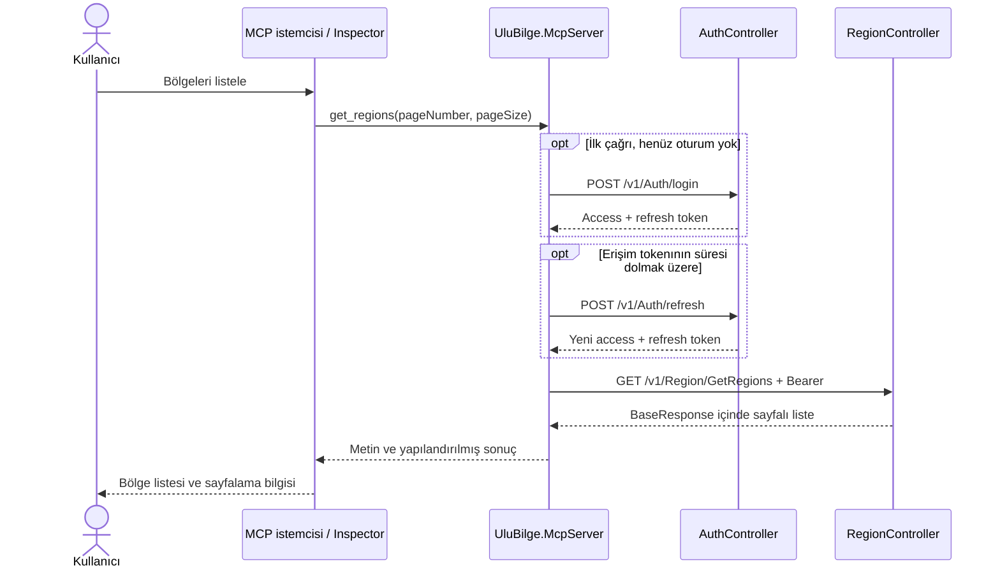

# UluBilge.McpServer — analiz ve uygulama önerisi

Tarih: 30.10.2026  
Durum: Kullanıcı onayı bekleniyor. Bu aşamada yalnızca analiz hazırlanmıştır.

## 1. Amaç ve ilk teslimat

`src/UluBilge.McpServer` altında .NET 10 ile bir MCP sunucusu oluşturulması öneriliyor. İlk araç, mevcut API'nin Region listeleme işlemini çağıracak ve sonucu MCP istemcisinin ekranında gösterecek.

İlk teslimatın akışı:

1. MCP istemcisi `UluBilge.McpServer` sürecini başlatır.
2. Kullanıcı, istemciden bölgeleri listelemesini ister.
3. Sunucu, `AuthController` üzerinden kimlik doğrular.
4. Elde ettiği erişim tokenıyla `RegionController.GetRegionsAsync` işlemini çağırır, ilerde reflesh token ile yenileme yapılabilir.
5. Bölge listesi ve sayfalama bilgileri MCP istemcisinde görüntülenir.

Bu belgeye verilen onay, aşağıdaki yerel, tek kullanıcıya ait süreç ve `stdio` taşıma önerisi için uygulama başlangıcı olacaktır. Uygulama kodu onaydan sonra yazılacaktır.

## 2. Mevcut projede doğrulanan sözleşmeler

| Konu | Mevcut davranış | MCP sunucusuna etkisi |
| --- | --- | --- |
| Giriş | `POST /v1/Auth/login`, JSON: `userName`, `password` | Kimlik doğrulama mevcut HTTP uç noktasından yapılacak. |
| Token yanıtı | `accessToken`, `tokenType`, `expiresIn`, `expiresAtUtc`, `refreshToken`, `refreshTokenExpiresAtUtc` | Token ve sona erme zamanları süreç belleğinde tutulacak. |
| Yenileme | `POST /v1/Auth/refresh`, JSON: `refreshToken` | Rotasyonla dönen yeni access ve refresh token birlikte saklanacak. |
| Çıkış | `POST /v1/Auth/logout`, Bearer token | API'den yapılan oturum iptalinin MCP çağrılarına etkisi korunacak. |
| Kullanıcı bilgisi | `GET /v1/Auth/me`, Bearer token | Canlı doğrulama sırasında kullanılabilir; ilk araç için zorunlu ek çağrı olmayacak. |
| Region listeleme | `GET /v1/Region/GetRegions?pageNumber=1&pageSize=20` | MCP aracı bu uç noktaya HTTP GET gönderecek. |
| Yetki | Controller üzerinde `RoleAuthorize(RoleEnum.Admin)` | API kullanıcısının Admin rolünü içermesi gerekiyor. Başarılı login tek başına yeterli değil. |
| Sayfalama | `pageNumber >= 1`, `1 <= pageSize <= 100`; varsayılanlar 1 ve 20 | Aynı sınırlar araç girdilerinde de uygulanacak. |
| Başarılı yanıt | Dışta `BaseResponse.Data`, içinde `PagedResult.Data` | API yanıtındaki `data.data` doğru ayrıştırılacak. |
| Hatalar | HTTP durum kodları ve Türkçe Problem Details | API hataları istemciye anlaşılır MCP araç hatası olarak aktarılacak. |

Kaynak kod bağlantıları:

- [AuthController](../src/UluBilge.Api/Controllers/AuthController.cs)
- [RegionController](../src/UluBilge.Api/Controllers/RegionController.cs)
- [BaseController ve route tanımı](../src/UluBilge.Api/Controllers/BaseController.cs)
- [GetRegionsAsync query ve handler](../src/UluBilge.App/Queries/RegionHandler/GetRegionsAsync.cs)
- [TokenResponse sözleşmesi](../src/UluBilge.Api/Authentication/IUserAuthenticationService.cs)
- [Mevcut token yönetimi](../src/UluBilge.Api/Authentication/DatabaseUserAuthenticationService.cs)

Route içindeki action adı `GetRegions` şeklindedir. C# metot adındaki `Async` son eki HTTP adresine eklenmeyecek.

## 3. Önerilen mimari



MCP sunucusu API'nin HTTP istemcisi olacak. Böylece kimlik doğrulama, rol kontrolü, iş kuralları, CQRS ve veritabanı işlemleri mevcut API akışından geçecek. MCP projesinin `Api`, `App` veya `Data` projelerine doğrudan referans vermesine gerek olmayacak; HTTP sözleşmeleri için küçük istemci DTO'ları kullanılacak.

İlk sürüm için resmi C# MCP SDK'sının `ModelContextProtocol` paketi ve .NET Generic Host öneriliyor. SDK, yerel süreç iletişimi için `stdio`, ASP.NET Core barındırması için ayrı HTTP desteği sunuyor. Uygulama sırasında uyumlu, kararlı paket sürümleri doğrulanıp proje dosyasında sabitlenecek. [Resmi SDK başlangıç rehberi](https://github.com/modelcontextprotocol/csharp-sdk/blob/main/docs/concepts/getting-started.md)

### Taşıma kararı: ilk sürümde stdio

Önerilen kullanım, yerel MCP istemcisinin sunucuyu kendi alt süreci olarak başlatmasıdır. Bir süreç, yapılandırılan tek API kullanıcısına ait tokenları tutacak. Bu yaklaşımda API kimlik bilgileri ortamdan veya geliştirme sırasında user-secrets üzerinden alınacak. MCP'nin HTTP yetkilendirme akışı ile stdio kimlik bilgisi yönetimi farklıdır. [MCP yetkilendirme belirtimi](https://modelcontextprotocol.io/specification/2026-07-28/basic/authorization)

Bu seçim, istemcinin stdio sunucularını çalıştırabildiği varsayımına dayanıyor. Hedef, uzak istemcilerin bir `/mcp` HTTP adresine bağlanması veya aynı sunucuyu birden fazla kullanıcının paylaşmasıysa taşıma ve kullanıcı oturumu tasarımı değişmelidir. Mevcut `AuthController`, kullanıcı adı/parola ile JWT üreten bir API'dir; tek başına MCP HTTP yetkilendirmesinin OAuth keşif ve yetkilendirme uç noktalarını sağlamaz. Uzak erişim istenirse bu konu uygulamadan önce ayrıca netleştirilecektir.

## 4. Kimlik doğrulama ve token yaşam döngüsü

1. Sunucu başlatılırken yapılandırma doğrulanacak; API'ye giriş ilk `get_regions` çağrısında yapılacak. Böylece araç keşfi API'nin o anda erişilebilir olmasına bağlı olmayacak.
2. `POST /v1/Auth/login` çağrısına yapılandırılmış kullanıcı adı ve parola gönderilecek.
3. Access token, refresh token ve sunucunun döndürdüğü bitiş zamanları yalnızca bellekte saklanacak. Tokenlar araç çıktısına, loglara veya proje dosyalarına yazılmayacak.
4. Region isteğine `Authorization: Bearer <accessToken>` başlığı istek bazında eklenecek.
5. Erişim tokenının süresi dolmadan kısa süre önce, örneğin 30 saniyelik eşikle, mevcut refresh token kullanılarak yenileme yapılacak. Süre hesabında API yanıtı ve test edilebilir `TimeProvider` kullanılacak.
6. Aynı süreçte eş zamanlı araç çağrıları olabileceği için ilk giriş ve yenileme bir kilitle koordine edilecek. Kilit alındıktan sonra token durumu tekrar kontrol edilecek. Aynı refresh tokenla birden fazla yenileme isteği gönderilmeyecek.
7. Refresh yanıtındaki iki token birlikte güncellenecek. Ağ kesintisi gibi sonucunun belirsiz olduğu bir refresh isteği, eski tokenla otomatik tekrarlanmayacak; mevcut API tokenı tüketmiş olabilir.
8. API'den oturum geçersizliğini belirten `401` gelirse tokenlar temizlenecek ve yeniden kimlik doğrulama gerektiği bildirilecek. Yeni login yaparak reddedilen istek sessizce tekrarlanmayacak. İlk sürümde bu durumdan çıkış, kullanıcı yapılandırmasının kontrol edilip MCP sürecinin yeniden başlatılmasıyla sağlanacak.
9. `403` yetki hatası olarak gösterilecek; kullanıcıya Admin rolü gerektiği açıklanacak. Parola tekrar denemeleri yapılmayacak.
10. `429` durumunda API'nin bekleme bilgisi aktarılacak; giriş ve refresh isteklerine otomatik retry eklenmeyecek.

İlk MCP araç listesinde yalnızca `get_regions` bulunacak. Giriş bilgileri araç parametresi olmayacak; kimlik doğrulama sunucunun yapılandırması üzerinden gerçekleşecek.

## 5. İlk MCP aracının sözleşmesi

Araç adı: `get_regions`

Açıklama: UluBilge API'den bölgeleri sayfalı olarak listeler. API kullanıcısının Admin yetkisi gerekir.

| Parametre | Tip | Varsayılan | Doğrulama |
| --- | --- | --- | --- |
| `pageNumber` | integer | 1 | En az 1 |
| `pageSize` | integer | 20 | 1–100 |

Araç, API'deki dış yanıt zarfını ayrıştırarak aşağıdaki biçimde bir sonuç döndürecek:

```json
{
  "items": [
    { "regionId": 1, "regionDescription": "Eastern" },
    { "regionId": 2, "regionDescription": "Western" }
  ],
  "total": 4,
  "pageNumber": 1,
  "pageSize": 2
}
```

Bu veri yalnızca örnektir; uygulamada API'nin gerçek yanıtı gösterilecek.

İstemcinin gösterebilmesi için MCP sonucunda hem okunabilir metin hem de şeması belirtilmiş yapılandırılmış içerik bulunması öneriliyor. SDK bu iki çıktı biçimini destekliyor. [Resmi SDK araç rehberi](https://github.com/modelcontextprotocol/csharp-sdk/blob/main/docs/concepts/tools/tools.md)

Metin çıktısı bölge numarası, açıklaması, toplam kayıt ve sayfa bilgisini içerecek. Sonuç boşsa, sayfanın boş olduğu açıkça belirtilecek. Hata durumunda başarılı boş liste üretmek yerine MCP araç hatası döndürülecek.

## 6. “Ekranda gösterme” yaklaşımı

İlk örnek için ekran, MCP Inspector veya sunucuya bağlanan MCP istemcisinin sonuç ekranı olarak ele alınıyor. Kullanıcı `get_regions` aracını çağırdığında liste bu ekranda görülecek. MCP Inspector, yerel sunucuya bağlanıp araçları keşfetmek ve çağrı sonuçlarını incelemek için kullanılabilir. [Resmi Inspector rehberi](https://modelcontextprotocol.io/docs/2026-07-28/tools/inspector)

Örnek kullanım:

1. `UluBilge.Api` HTTPS profiliyle çalıştırılır; mevcut profile göre adres `https://localhost:7187` olur.
2. MCP sunucusunun API adresi ve kullanıcı bilgileri yapılandırılır.
3. Solution derlenir.
4. Inspector, derlenmiş MCP sunucusu DLL'ini `dotnet` ile başlatacak şekilde açılır.
5. Araç listesinden `get_regions` seçilir; `pageNumber=1`, `pageSize=20` girilir.
6. Gerçek API sonucu istemcinin ekranında görüntülenir.

İstemci komutunda derlenmiş DLL'in mutlak yolu kullanılacak. `stdout` yalnızca MCP mesajlarına ayrılacak; uygulama logları `stderr` üzerinden yazılacak. Böylece ekrana yazılan loglar protokol iletişimini bozmayacak. [Resmi SDK stdio örneği](https://github.com/modelcontextprotocol/csharp-sdk/blob/main/docs/concepts/getting-started.md)

## 7. Önerilen dosya ve sorumluluk dağılımı

```text
src/
  UluBilge.McpServer/
    UluBilge.McpServer.csproj
    Program.cs
    appsettings.json
    Configuration/
      UluBilgeApiOptions.cs
    Authentication/
      ApiTokenProvider.cs
    Clients/
      UluBilgeApiClient.cs
    Contracts/
      AuthContracts.cs
      RegionContracts.cs
    Tools/
      RegionTools.cs
tests/
  UluBilge.McpServer.Tests/
docs/
  mcpserver-analiz.md
  mcpserver-kullanim.md
```

| Bileşen | Sorumluluk |
| --- | --- |
| `Program.cs` | Generic Host, yapılandırma, bağımlılık kaydı, stdio taşıma ve araç kaydı. |
| `UluBilgeApiOptions` | API adresi, kimlik bilgileri ve zaman aşımı ayarları; başlangıç doğrulaması. |
| `ApiTokenProvider` | Giriş, token önbelleği, koordineli refresh ve geçersiz oturum durumu. |
| `UluBilgeApiClient` | `IHttpClientFactory` üzerinden sabit API adresine HTTP çağrıları, JSON ayrıştırma ve API hata eşlemesi. |
| `Contracts` | Auth ve Region HTTP yanıtları ile MCP araç sonucunun DTO'ları. |
| `RegionTools` | MCP girdilerinin doğrulanması, API çağrısının başlatılması ve MCP çıktısı. |
| Test projesi | Sahte HTTP yanıtlarıyla token akışı, sözleşme ve MCP iletişim kontrolleri. |

Yeni MCP projesi ve test projesi `UluBilge.slnx` dosyasına eklenecek. Çalıştırma ve istemci bağlantısı için kullanım belgesi hazırlanacak; README'ye ilgili yönlendirme eklenecek.

## 8. Yapılandırma ve çalışma koşulları

Önerilen ayarlar:

| Anahtar | Öneri |
| --- | --- |
| `UluBilgeApi:BaseUrl` | Yerelde `https://localhost:7187/`; dağıtım ortamında yapılandırılan HTTPS API adresi. |
| `UluBilgeApi:UserName` | API'de geçerli ve Admin rolünü içeren kullanıcı. |
| `UluBilgeApi:Password` | Geliştirmede user-secrets; diğer ortamlarda güvenli yapılandırmadan sağlanan değer. |
| `UluBilgeApi:TimeoutSeconds` | İlk varsayılan önerisi 30 saniye. |

Ortam değişkeni karşılıkları `UluBilgeApi__BaseUrl`, `UluBilgeApi__UserName`, `UluBilgeApi__Password` ve `UluBilgeApi__TimeoutSeconds` olacak. Repo içindeki örnek yapılandırmada gerçek kullanıcı adı, parola veya token bulunmayacak.

MCP istemcisinin çalışma dizini farklı olabileceğinden dosya tabanlı ayarlar uygulamanın çıktı dizininden yüklenecek. Ortam değişkenleri dosyadaki değerleri geçersiz kılabilecek; geliştirme user-secrets desteği açıkça yapılandırılacak.

API sertifikasının istemci tarafından güvenilir olması gerekiyor. HTTP istemcisinde sertifika denetimini kapatan bir ayar eklenmeyecek. Kimlik bilgileri yalnızca yapılandırılmış API adresine gönderilecek; tool girdilerinden hedef URL alınmayacak ve otomatik HTTP yönlendirmeleri izlenmeyecek.

Canlı gösterim için mevcut API'nin, Northwind şemasının ve Users/UserTokens tablolarının çalışır durumda olması gerekiyor. Migration çalıştırılması ayrı bir kurulum işlemi olarak ele alınacak; MCP sunucusu migration başlatmayacak.

## 9. Hata davranışı

| Durum | Beklenen MCP sonucu |
| --- | --- |
| Geçersiz sayfalama | API çağrısı yapılmadan açıklayıcı araç hatası. |
| Yanlış kullanıcı adı/parola | Kimlik doğrulama başarısız hatası; parola veya ham token yanıtı gösterilmez. |
| Geçersiz/iptal edilmiş oturum | Yeniden kimlik doğrulama gerektiğini belirten hata. |
| Yetersiz rol | Admin yetkisi gerektiğini belirten hata. |
| API hız sınırı | Bekleme gerektiğini ve varsa `Retry-After` bilgisini belirten hata. |
| API erişilemiyor / zaman aşımı | Bağlantı veya zaman aşımı hatası. |
| Bozuk/beklenmeyen JSON | API yanıt sözleşmesinin karşılanmadığını belirten hata. |
| API 5xx | Güvenli işlem hatası; varsa `traceId` korunur. |
| İstemci iptali | İptal sinyali bekleyen kilide ve HTTP isteğine iletilir. |

Kimlik doğrulama istek/yanıt gövdeleri loglanmayacak. API'den gelen hata içeriği güvenli alanlarla sınırlandırılarak aktarılacak.

## 10. Onay sonrasındaki uygulama sırası

1. `src/UluBilge.McpServer` projesini oluşturup solution'a eklemek; resmi SDK ve gerekli .NET bağımlılıklarını sabitlemek.
2. Yapılandırma, DTO'lar ve HTTP istemcisini hazırlamak.
3. Giriş, token saklama, koordineli refresh ve oturum hatalarını uygulamak.
4. `get_regions` aracını ekleyip API listesini metin ve yapılandırılmış içerik olarak döndürmek.
5. Gerçek veritabanı gerektirmeyen anlamlı testleri eklemek ve çalıştırmak.
6. API/veritabanı erişimi hazırsa gerçek kullanıcıyla Inspector üzerinden listeyi göstermek.
7. Kullanım belgesini ve README yönlendirmesini tamamlamak.

## 11. Kabul ölçütleri ve doğrulama

- `dotnet build UluBilge.slnx` başarılı olmalı.
- Testlerde MCP araç keşfi yapılabilmeli ve `get_regions` görünmeli. İletişim testi seçilen SDK sürümünün desteklediği protokol akışına göre yürütülmeli.
- İlk araç çağrısı önce `/v1/Auth/login`, ardından Bearer başlığıyla `/v1/Region/GetRegions` çağırmalı.
- Geçerli token varken sonraki Region çağrısı yeniden login yapmamalı.
- Süre yaklaşınca refresh çalışmalı ve yeni refresh token sonraki yenilemede kullanılmalı.
- Eş zamanlı çağrılar aynı refresh tokenı birden fazla kez tüketmemeli.
- Refresh isteğinin sonucu belirsizse eski tokenla otomatik tekrar yapılmamalı.
- `401`, `403`, `429`, zaman aşımı ve bozuk JSON senaryoları doğru hatayla sonuçlanmalı.
- API'nin `data.data`, toplam ve sayfa alanları doğru ayrıştırılmalı; boş sayfa desteklenmeli.
- Geçersiz sayfalama değerleri ağ isteği başlatmamalı; iptal sinyali HTTP isteğine ulaşmalı.
- MCP sonucunda ve loglarda parola, access token veya refresh token bulunmamalı; `stdout` protokol mesajlarını korumalı.
- Canlı gösterimde Inspector ekranında veritabanından gelen gerçek Region kayıtları görülmeli. Canlı ortam hazır değilse bu ölçütün doğrulanamadığı açıkça raporlanmalı; sahte veri gerçek sonuç gibi sunulmamalı.

## 12. Mevcut API ile ilgili sınırlar ve onaya sunulan karar

Önceki incelemede saptanan `SecurityStamp` değişikliğinin eski refresh tokenı tek başına geçersiz kılmaması API tarafında halen mevcut. MCP sunucusu mevcut API oturum davranışını kullanacağından bu açık API'de ayrıca giderilmelidir. Bu analiz, söz konusu açığın çözüldüğünü varsaymıyor.

İlk teslimat, MCP entegrasyonu ve Region listeleme örneğiyle sınırlı tutuluyor. Mevcut kullanıcı yönetimi ve migration davranışlarına ilişkin kapsam genişlemesi ayrıca kararlaştırılabilir.

Onaya sunulan öneri: **`src/UluBilge.McpServer` altında yerel stdio MCP sunucusu; süreç başına tek API kullanıcısı; AuthController üzerinden login/refresh; `get_regions` aracı; sonuçların MCP Inspector veya bağlı istemci ekranında gösterilmesi.**
